# Cross-Source Ganoderma Detection from UAV Imagery

## Complete Experiment Process and Preliminary Technical Results

**Project:** `ganoderma_uav_research_starter`<br>
**Task:** Single-class object detection of basal stem rot (BSR/Ganoderma) in oil-palm UAV imagery<br>
**Experiment seed:** 42<br>
**Result snapshot:** 11 August 2026<br>
**Status:** Partial benchmark. All YOLO experiments are complete; only RF-DETR-S B0 is included in the consolidated metrics at this snapshot. RF-DETR-S B1/B2, TinyFormer-S-PBM, and DEIMv2-S are still pending or running.

> This document is a technical record of the implemented experiment. Conclusions labelled *preliminary* must be updated after every planned model and scenario has completed.

## Abstract

Basal stem rot caused by *Ganoderma* is an important disease of oil palm, and UAV imagery offers a scalable way to inspect plantations. A detector trained on one public UAV dataset may nevertheless fail on another because camera properties, flight altitude, plantation structure, illumination, image resolution, and annotation practices produce a substantial source-domain shift. This experiment evaluates whether offline geometric augmentation and cross-source Fourier Domain Adaptation (FDA) improve single-class BSR detection across two public datasets. The two sources are harmonized into one foreground class, while Healthy and Non-BSR examples are retained as background. A leakage-resistant, group-aware split is created before source-specific tiling. Three nested training scenarios are then compared: B0 uses the prepared original training images, B1 adds one horizontal/vertical geometric copy of every training image, and B2 additionally adds one cross-source FDA copy of every original image. Validation and test data are byte-identical across scenarios.

Seven small detector families are included in the complete benchmark design: YOLOv10-S, YOLO11-S, YOLOv12-S, YOLOv13-S, RF-DETR-S, TinyFormer-S-PBM, and DEIMv2-S. Predictions are converted to a common COCO representation and evaluated separately for Source A, Source B, and both sources combined. The main outcome is COCO mAP50–95 on the complete test set (`primary_full`, `COMBINED`). A secondary `balanced_diagnostic` view retains all positive images but limits background-only images, allowing the influence of background prevalence to be examined.

In the currently completed YOLO experiments, geometric augmentation improves combined primary-full mAP50–95 for every architecture. The mean across the four YOLO families increases from 0.2627 in B0 to 0.3244 in B1. Adding FDA raises the four-model mean to 0.3411, but the effect is architecture-dependent: YOLOv10-S and YOLO11-S improve, while YOLOv12-S and YOLOv13-S decline relative to B1. RF-DETR-S B0 currently gives the strongest individual result, with combined primary-full mAP50–95 of 0.4875, but RF-DETR-S B1/B2 are not yet available. The present results therefore support geometric augmentation consistently, while conclusions about FDA and the overall best detector remain preliminary.

## 1. Research objective

The experiment addresses four questions:

1. How well do modern small object detectors identify BSR in a test set assembled from two independent UAV data sources?
2. Does offline horizontal/vertical geometric augmentation improve detection relative to original prepared training data?
3. Does cross-source Fourier amplitude mixing provide an additional benefit beyond the geometric pipeline?
4. Are improvements consistent across Source A and Source B, or do they conceal source-specific failure modes?

The principal ablations are:

- **B1 minus B0:** contribution of offline geometric augmentation.
- **B2 minus B1:** incremental contribution of FDA on top of the same geometric pipeline.
- **B2 minus B0:** total effect of geometric augmentation plus FDA; this is **not** a pure FDA comparison.

## 2. End-to-end experiment flow

```mermaid
flowchart LR
    A[Download or recover Source A and B] --> B[Audit source images and labels]
    B --> C[Harmonize labels to BSR and background]
    C --> D[Group-aware 70/15/15 split]
    D --> E[Source-specific tiling]
    E --> F[Build B0, B1, and B2 training scenarios]
    F --> G[Export identical YOLO and COCO views]
    G --> H[Train each detector with seed 42]
    H --> I[Predict on primary and balanced test views]
    I --> J[Common COCO evaluation by A, B, and COMBINED]
    J --> K[Consolidated CSV, plots, and technical report]
```



The design separates data construction from model-native training. Offline augmentation is created once and reused by every model family. Model-internal stochastic augmentation is disabled as far as each framework permits, preventing one architecture from receiving an unreported augmentation advantage.

## 3. Dataset

### 3.1 Public sources

| Internal name | Public Roboflow project | Configured version | Role |
|---|---|---:|---|
| Source A | `m-rizky-pribadi/ganoderma-detection-oil-palm-afp9b` | 6 | UAV Ganoderma/BSR imagery; tiled after the group split |
| Source B | `adnans-object-detection/oil-palm-bsr-disease-detection` | 1 | UAV BSR imagery including Healthy/Non-BSR negatives |

The exact acquisition configuration is recorded in [datasets.yaml](../configs/datasets.yaml). Public dataset versions can change, so the project records the version and audits the local files rather than assuming that the remote project remains unchanged.

### 3.2 Source recovery and label harmonization

Source A was distributed with multiple Roboflow-derived versions of some images. The recovery stage groups filenames by their original identity, rejects near-black candidates, and selects one representative per original image. This prevents public platform augmentation from contaminating the controlled B0/B1/B2 ablation.

Labels from both sources are mapped to one foreground category:

- `ganoderma` and `bsr` become **BSR**, COCO category ID 0.
- `healthy`, `non-bsr`, `non_bsr`, and `non bsr` are not treated as alternative foreground classes. Those images are retained as background/negative examples.

This is therefore a one-class object-detection experiment, not a multi-class disease-classification experiment.

### 3.3 Leakage-resistant split

A deterministic group-aware split is performed before tiling or offline augmentation, using ratios 70% train, 15% validation, and 15% test. Groups correspond to source video/block identities, so adjacent frames or tiles from the same acquisition group cannot be distributed across train and test.

The audit reports:

- group leakage: 0;
- exact original-image hash leakage: 0;
- exact cross-split duplicate leakage: 0;
- invalid labels: 0;
- overall method audit status: **PASS**.

Before tiling, Source A contributes 320/91/64 train/validation/test images and Source B contributes 594/147/118 images. The source groups assigned to each split are recorded in [group_split_summary.json](method_b/group_split_summary.json).

### 3.4 Tiling and prepared baseline

The active Method B configuration tiles Source A into 320 x 320 crops with 20% overlap. A bounding box must retain at least 50% visibility to be kept in a tile. Empty tiles are retained subject to a training background-to-positive cap. Source B remains at its prepared image scale. Tiling is performed only after the group split so that multiple tiles from one original cannot leak across splits.

The resulting B0 dataset is:

| Split | Images | Source A | Source B | BSR boxes | Background-only images |
|---|---:|---:|---:|---:|---:|
| Train | 1,179 | 585 | 594 | 890 | 485 |
| Validation | 511 | 364 | 147 | 203 | 341 |
| Test | 374 | 256 | 118 | 149 | 239 |

The large number of background-only Source A tiles is intentional and represents the small-object search problem, but it can strongly influence false-positive behaviour. For this reason, the full evaluation is accompanied by the balanced diagnostic described below.

## 4. Training scenarios

The scenario definitions are generated by [04_build_scenarios.py](../scripts/04_build_scenarios.py) under the active [method_b.yaml](../configs/method_b.yaml) configuration.

| Scenario | Training images | Construction | Purpose |
|---|---:|---|---|
| B0 | 1,179 | Prepared original training images | No-offline-augmentation baseline |
| B1 | 2,358 | B0 plus one geometric copy per image | Test geometric augmentation |
| B2 | 3,537 | B1 plus one geometrically transformed FDA copy per original | Test incremental FDA contribution |

Validation and test images are identical across B0, B1, and B2. Only the training split changes. The audit verifies `B1 = 2 x B0` and `B2 = 3 x B0` exactly.

### 4.1 B1 geometric augmentation

For every B0 training image, B1 creates one offline copy using:

- horizontal flip probability: 0.50;
- vertical flip probability: 0.50;
- 90-degree rotation probability: 0;
- affine, scaling, translation, and arbitrary rotation: disabled.

The associated boxes are transformed with the image. These copies are materialized on disk and shared across all detector frameworks.

### 4.2 B2 Fourier Domain Adaptation

B2 inherits the B0 originals and the exact B1 geometric copies. It then creates one additional FDA sample for every B0 original. A content image from one source uses a deterministic donor from the other source. Mixing is bidirectional, so both A-to-B and B-to-A adaptation are represented.

For a content image with Fourier transform

$$
F_c = A_c e^{i\phi_c},
$$

the low-frequency amplitude region is mixed with donor amplitude $A_d$:

$$
A_{mix} = (1-\lambda)A_c + \lambda A_d,
$$

and the adapted image retains the content phase:

$$
x_{FDA} = \mathcal{F}^{-1}\left(A_{mix}e^{i\phi_c}\right).
$$

The active settings are:

- low-frequency region parameter `beta = 0.01`;
- mixing strength `lambda = 0.35`;
- bidirectional cross-source donors: enabled;
- donor resizing: enabled;
- one FDA copy per eligible original: 1,179 total;
- the same H/V geometric transform policy is applied to the FDA copy.

The phase retains scene structure and label geometry, while the low-frequency amplitude introduces appearance statistics from the other source.

### 4.3 Documentation clarification

The introductory paragraph of the original README describes B1 as geometric augmentation plus Fourier mixing. That sentence is stale. The implemented scenario builder, generated scenario summary, audit assertions, and reporting scripts consistently define B1 as geometric-only and B2 as the added-FDA scenario. This report follows the implemented and audited definition.

## 5. Evaluation views

### 5.1 Primary full

`primary_full` contains the complete held-out validation or test split. The full test view has 374 images and 149 BSR boxes:

| Source | Images | Positive images | Background-only images | BSR boxes |
|---|---:|---:|---:|---:|
| A | 256 | 62 | 194 | 70 |
| B | 118 | 73 | 45 | 79 |
| Combined | 374 | 135 | 239 | 149 |

This is the principal evaluation view because it preserves the actual held-out distribution, including the large background search space.

### 5.2 Balanced diagnostic

`balanced_diagnostic` keeps every positive image and limits background-only images to no more than one per positive image within each source. Its test composition is:

| Source | Images | Positive images | Background-only images | BSR boxes |
|---|---:|---:|---:|---:|
| A | 124 | 62 | 62 | 70 |
| B | 118 | 73 | 45 | 79 |
| Combined | 242 | 135 | 107 | 149 |

The diagnostic removes 132 excess Source A background tiles and removes no positive image or box. Source B is already within the 1:1 cap, so its images and metrics are identical in both evaluation views.

Balanced metrics answer whether excessive background prevalence is driving false positives. They must not replace `primary_full` as the headline test result.

## 6. Detector families

| Model | Backend | Approx. parameters | Input | Benchmark status at snapshot |
|---|---|---:|---:|---|
| YOLOv10-S | Official YOLOv10 | 8.07 M | 640 | B0/B1/B2 complete |
| YOLO11-S | Ultralytics | 9.43 M | 640 | B0/B1/B2 complete |
| YOLOv12-S | Official YOLOv12 | 9.10 M | 640 | B0/B1/B2 complete |
| YOLOv13-S | Official YOLOv13 | 9.55 M | 640 | B0/B1/B2 complete |
| RF-DETR-S | RF-DETR, DINOv2 windowed-small backbone | 31.79 M | 512 | B0 complete; B1 running; B2 pending |
| TinyFormer-S-PBM | TinyFormer with DINOv3 configuration | 9.81 M | 640 | Preflight passed; full runs pending |
| DEIMv2-S | DEIMv2 with DINOv3 ViT-tiny backbone | 9.66 M trainable | 640 | Preflight passed; full runs pending |

Pretrained weights are used when required by the native implementation. The task-specific prediction heads are configured for one class. Every model is evaluated through the same COCO annotations and common prediction adapter rather than relying only on framework-native summary values.

## 7. Training protocol

The full benchmark launcher records the following effective settings:

| Setting | Value |
|---|---|
| Seed | 42 |
| Maximum epochs | 100 |
| Early-stopping patience | 10 validation records |
| Batch size | 32 |
| Data-loader workers | 2 |
| RF-DETR gradient accumulation | 1 |
| Device | A100 GPU, device 0 |
| Budget mode | `epoch_matched` |
| Validation frequency | Every epoch unless constrained by a native backend |

The command-line launcher overrides older defaults found in some YAML files. The values in `reports/benchmark/run_summary.json` and each run's `training_budget.json` are the effective experiment settings.

### 7.1 Fairness controls

- B0/B1/B2 use byte-identical validation and test images.
- The same seed, maximum epoch count, batch size, patience, and worker count are used where supported.
- Model-internal mosaic, mixup, color, perspective, scale, flip, and related stochastic augmentations are disabled as far as the native APIs permit.
- B1/B2 augmentations are generated offline and are therefore identical for every architecture.
- Training and test annotations use the same one-class mapping.
- Predictions from every framework are evaluated through one common COCO evaluator.

Native optimizer and architecture-specific training behaviour are retained where forcing identical settings would invalidate the official implementation. Consequently, this is a controlled pipeline comparison, not a claim that every internal optimizer operation is identical.

### 7.2 Epoch-matched budget interpretation

Every scenario can train for up to 100 epochs, but the number of batches per epoch increases with the augmented dataset:

| Scenario | Images | Batches per epoch at batch 32 | Planned maximum optimizer steps |
|---|---:|---:|---:|
| B0 | 1,179 | 37 | 3,700 |
| B1 | 2,358 | 74 | 7,400 |
| B2 | 3,537 | 111 | 11,100 |

This design answers whether the complete augmented training pipeline improves performance. It does not isolate augmentation from additional optimizer updates or computational budget. A separate step-matched ablation would be required to answer that stricter question.

### 7.3 Early stopping and checkpoints

Training stops after ten validation records without an improvement of at least the configured minimum delta. The best checkpoint, rather than the last checkpoint, is used for held-out inference. RF-DETR additionally maintains regular and exponential-moving-average (EMA) weights. Because an improvement resets patience, transformer runs can continue substantially longer than YOLO runs.

## 8. Common evaluation methodology

For each model-scenario pair, predictions are generated for both evaluation views. Every view produces three rows:

- `A`: only Source A images;
- `B`: only Source B images;
- `COMBINED`: both sources together.

Thus, one completed model-scenario run contributes six rows to `final_metrics.csv`.

### 8.1 Metrics

- **Precision:** $TP/(TP+FP)$.
- **Recall:** $TP/(TP+FN)$.
- **F1:** harmonic mean of precision and recall.
- **AP50:** average precision at IoU 0.50.
- **AP75:** average precision at the stricter IoU 0.75.
- **mAP50–95:** COCO average precision over IoU thresholds 0.50 through 0.95. This is the primary accuracy metric.
- **AR:** COCO average recall.

Precision, recall, and F1 are computed at IoU 0.50 by sweeping the prediction-confidence threshold and retaining the threshold that maximizes F1 for that evaluation subset. Consequently, these values are useful diagnostics but are optimistic and are not measurements at one fixed deployment threshold. mAP50–95 should be preferred for model ranking.

## 9. Results available in the current snapshot

The consolidated [final_metrics.csv](benchmark/final_metrics.csv) currently contains 78 rows:

- four YOLO families x three scenarios x six evaluation rows = 72 rows;
- RF-DETR-S B0 x six evaluation rows = 6 rows.

RF-DETR-S B1/B2, TinyFormer-S-PBM, and DEIMv2-S are absent. The filename means "consolidated metrics discovered so far," not that the entire planned benchmark is complete.

### 9.1 Main result: primary-full combined test set

| Model | Scenario | Precision | Recall | F1 | AP50 | AP75 | mAP50–95 |
|---|---|---:|---:|---:|---:|---:|---:|
| RF-DETR-S | B0 | 0.684 | 0.711 | 0.697 | 0.669 | 0.527 | **0.488** |
| YOLO11-S | B0 | 0.490 | 0.510 | 0.500 | 0.400 | 0.243 | 0.248 |
| YOLO11-S | B1 | 0.562 | 0.544 | 0.553 | 0.503 | 0.363 | 0.312 |
| YOLO11-S | B2 | 0.514 | 0.758 | 0.612 | 0.493 | 0.376 | 0.336 |
| YOLOv10-S | B0 | 0.363 | 0.523 | 0.429 | 0.310 | 0.211 | 0.207 |
| YOLOv10-S | B1 | 0.484 | 0.517 | 0.500 | 0.378 | 0.308 | 0.267 |
| YOLOv10-S | B2 | 0.571 | 0.597 | 0.584 | 0.504 | 0.429 | 0.367 |
| YOLOv12-S | B0 | 0.583 | 0.517 | 0.548 | 0.447 | 0.247 | 0.262 |
| YOLOv12-S | B1 | 0.493 | 0.752 | 0.596 | 0.491 | 0.370 | 0.338 |
| YOLOv12-S | B2 | 0.445 | 0.705 | 0.545 | 0.467 | 0.332 | 0.308 |
| YOLOv13-S | B0 | 0.505 | 0.718 | 0.593 | 0.485 | 0.359 | 0.334 |
| YOLOv13-S | B1 | 0.619 | 0.664 | 0.641 | 0.571 | 0.418 | 0.381 |
| YOLOv13-S | B2 | 0.471 | 0.826 | 0.600 | 0.520 | 0.355 | 0.353 |

### 9.2 Balanced-diagnostic combined mAP50–95

| Model | B0 | B1 | B2 |
|---|---:|---:|---:|
| RF-DETR-S | **0.527** | Pending | Pending |
| YOLO11-S | 0.269 | 0.342 | 0.350 |
| YOLOv10-S | 0.216 | 0.277 | 0.388 |
| YOLOv12-S | 0.281 | 0.355 | 0.348 |
| YOLOv13-S | 0.351 | 0.393 | 0.370 |

Balanced results are generally higher because predictions on 132 removed Source A background-only tiles can no longer contribute false positives. This does not mean the model improved; only the evaluation composition changed.

### 9.3 Effect of augmentation on completed YOLO models

| Model | B0 mAP | B1 mAP | B2 mAP | B1 - B0 | B2 - B1 |
|---|---:|---:|---:|---:|---:|
| YOLO11-S | 0.2477 | 0.3121 | 0.3363 | +0.0645 | +0.0242 |
| YOLOv10-S | 0.2067 | 0.2666 | 0.3670 | +0.0599 | +0.1004 |
| YOLOv12-S | 0.2624 | 0.3382 | 0.3084 | +0.0758 | -0.0298 |
| YOLOv13-S | 0.3340 | 0.3806 | 0.3528 | +0.0466 | -0.0279 |
| **Four-model mean** | **0.2627** | **0.3244** | **0.3411** | **+0.0617** | **+0.0167** |

All four completed YOLO families improve from B0 to B1. This is the most consistent result in the current experiment and supports offline H/V augmentation.

The FDA increment is not consistent. It provides a large gain for YOLOv10-S and a smaller gain for YOLO11-S, but it reduces mAP for YOLOv12-S and YOLOv13-S. B2 also tends to increase recall while sacrificing precision. For example, YOLOv13-S recall rises from 0.664 in B1 to 0.826 in B2, while precision falls from 0.619 to 0.471 and mAP declines. This suggests that FDA changes the detection operating behaviour and may increase false positives for some architectures.

### 9.4 Source-domain observations

The source-specific rows should be examined alongside the combined row because Source A and Source B have different image and background distributions. For RF-DETR-S B0:

| Evaluation | Source A mAP50–95 | Source B mAP50–95 | Combined mAP50–95 |
|---|---:|---:|---:|
| Primary full | 0.420 | 0.613 | 0.488 |
| Balanced diagnostic | 0.480 | 0.613 | 0.527 |

Source B is unchanged between views because no Source B images were removed. Source A improves by 0.060 when excess background tiles are removed, indicating that full-scene/background false positives are an important Source A error mode.

### 9.5 Current model ranking

RF-DETR-S B0 is currently the strongest available individual run on the main view, with mAP50–95 0.4875 and F1 0.6974. The best completed YOLO run is YOLOv13-S B1 at mAP50–95 0.3806, narrowly ahead of YOLOv10-S B2 at 0.3670. This ranking is provisional because the transformer-family scenario matrix is incomplete.

## 10. Training-time interpretation

RF-DETR-S is much slower than the YOLO families because it combines a transformer backbone, 300 object queries, matching-based detection losses, full validation each epoch, regular and EMA weights, and large checkpoints. B1 also has twice as many batches as B0, while B2 has three times as many. The A100 is not continuously compute-saturated during data loading, COCO evaluation, and checkpoint writing.

The completed RF-DETR-S B0 training took approximately 6,974 seconds, or 1 hour 56 minutes, and early-stopped after training epochs 0 through 34. Its current CSV metadata incorrectly displays `epochs_completed = 100`; that field contains the planned maximum rather than the observed completed epoch count for this run. The training log and metrics CSV are authoritative for the actual stopping point.

## 11. Threats to validity and reporting limitations

1. **Incomplete benchmark:** RF-DETR-S B1/B2, TinyFormer-S-PBM, and DEIMv2-S must finish before declaring the overall best model or the transformer-specific augmentation effect.
2. **Single seed:** all current results use seed 42. Without repeated seeds, random variation and confidence intervals are unknown.
3. **Epoch-matched rather than update-matched:** B1 and B2 receive two and three times as many training samples and planned optimizer steps as B0. Gains cannot be attributed solely to image diversity.
4. **Optimized F1 threshold:** P/R/F1 use the best threshold found on the evaluated subset and should not be presented as fixed deployment performance.
5. **Public dataset provenance:** Roboflow versions can contain hidden preprocessing or generated derivatives. The local recovery and audits reduce this risk but should remain part of the artifact bundle.
6. **Source imbalance:** Source A includes many tiled background images. `primary_full` is realistic for the prepared test set, while `balanced_diagnostic` is only a controlled secondary view.
7. **Correlated augmented samples:** B1 and B2 copies are transformations of B0 training images rather than independent acquisitions.
8. **Architecture-native differences:** input size is 512 for RF-DETR-S and 640 for the other configured models; official optimizers and pretrained representations also differ.
9. **Metadata issue:** RF-DETR-S B0 currently records the requested epoch count as completed epochs. This must be corrected before producing the final publication table.

## 12. Reproducibility and artifact map

### 12.1 Key configuration and audit files

- Dataset acquisition: [configs/datasets.yaml](../configs/datasets.yaml)
- Active Method B construction: [configs/method_b.yaml](../configs/method_b.yaml)
- Model registry: [configs/benchmark.yaml](../configs/benchmark.yaml)
- Scenario builder: [scripts/04_build_scenarios.py](../scripts/04_build_scenarios.py)
- Common evaluator: [scripts/common_coco_evaluator.py](../scripts/common_coco_evaluator.py)
- Scenario summary: [reports/method_b/scenario_build_summary.pretty.json](method_b/scenario_build_summary.pretty.json)
- Dataset/method audit: [reports/method_b/method_b_audit.json](method_b/method_b_audit.json)
- Active run summary: [reports/benchmark/run_summary.json](benchmark/run_summary.json)
- Consolidated results: [reports/benchmark/final_metrics.csv](benchmark/final_metrics.csv)

### 12.2 Main commands

Rebuild and audit the Method B dataset without starting training:

```bash
python scripts/rebuild_method_b.py
```

Run the full benchmark orchestrator using the effective experiment settings:

```bash
python scripts/run_benchmark_auto.py \
  --mode full \
  --models yolov10s,yolo11s,yolov12s,yolov13s,rfdetrs,tinyformers,deimv2s \
  --scenarios B0,B1,B2 \
  --epochs 100 \
  --batch 32 \
  --patience 10 \
  --device 0 \
  --workers 2 \
  --rf-batch 32 \
  --rf-grad-accum 1 \
  --budget-mode epoch_matched
```

Regenerate the report figures after metrics have been consolidated:

```bash
python scripts/09_generate_report_figures.py
python scripts/11_generate_detector_figures.py
```

## 13. Preliminary conclusion

The implemented experiment provides a leakage-audited, cross-source comparison of offline augmentation for UAV-based BSR detection. The completed YOLO matrix shows a robust positive effect from geometric augmentation: every YOLO family improves from B0 to B1 on the complete combined test set. FDA produces a positive mean change but is not uniformly beneficial, improving YOLOv10-S and YOLO11-S while reducing YOLOv12-S and YOLOv13-S performance. The result suggests that Fourier appearance transfer interacts with architecture and confidence calibration rather than acting as a universal improvement.

RF-DETR-S B0 currently outperforms every completed YOLO run, but the detector comparison and the B0/B1/B2 conclusion cannot be finalized until RF-DETR-S B1/B2, TinyFormer-S-PBM, and DEIMv2-S complete. The final report should prioritize primary-full combined mAP50–95, use the balanced view to explain background sensitivity, include source-specific results to expose domain shift, and report repeated-seed uncertainty if compute permits.

## 14. Finalization checklist

- [x] Dataset recovery, harmonization, group split, tiling, and leakage audit complete.
- [x] B0/B1/B2 construction and identity audit complete.
- [x] YOLOv10-S B0/B1/B2 complete.
- [x] YOLO11-S B0/B1/B2 complete.
- [x] YOLOv12-S B0/B1/B2 complete.
- [x] YOLOv13-S B0/B1/B2 complete.
- [ ] RF-DETR-S B1/B2 complete and consolidated.
- [ ] TinyFormer-S-PBM B0/B1/B2 complete and consolidated.
- [ ] DEIMv2-S B0/B1/B2 complete and consolidated.
- [ ] RF-DETR completed-epoch metadata corrected.
- [ ] Final figures regenerated after all runs.
- [ ] Optional repeated-seed experiments and uncertainty intervals added.
- [ ] Abstract, results, ranking, and conclusion updated from preliminary to final.
